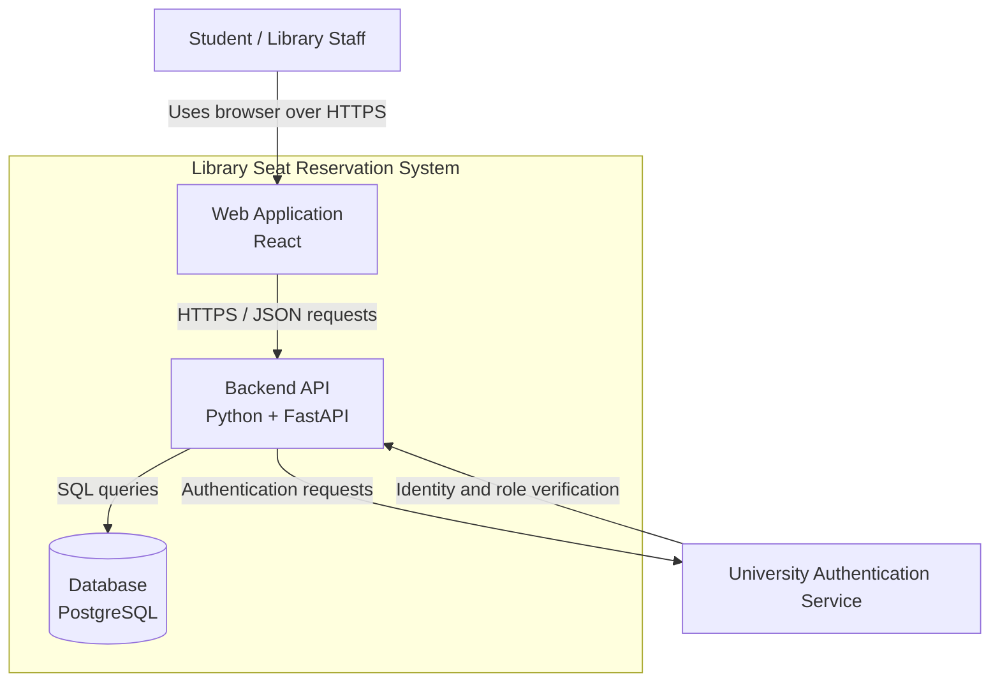

# Container Diagram — Library Seat Reservation System

## Containers

| Container | Responsibility |
|---|---|
| Web Application | Provides the interface for students and library staff. |
| Backend API | Handles reservations, validates availability, prevents overlapping bookings, and enforces access rules. |
| Database | Stores seats, reservation records, and necessary user references. |

## Diagram

## Relationships

1. Students and library staff use the web application through a browser.
2. The web application sends HTTPS/JSON requests to the backend API.
3. The backend API reads and writes seat and reservation data in PostgreSQL.
4. The backend API communicates with the university authentication service to verify user identity and roles.

## Architecture Note

The system uses Layered Architecture. The web application handles presentation, the backend handles business logic, and PostgreSQL provides persistent storage. University authentication is an external service.
